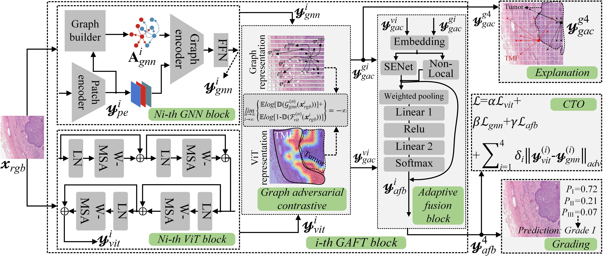

# GAFT: Graph Adversarial Fusion Transformer for Topology-aware Tumor-Microenvironment Interaction Modeling in LSCC

Official PyTorch implementation of **GAFT (Graph Adversarial Fusion Transformer)** for tumor-microenvironment-aware pathological classification of laryngeal squamous cell carcinoma (LSCC).

This repository is organized to support **reproducible training, evaluation, preprocessing, and model inspection**. The release includes source code, a pinned software environment, patient-level split manifests, preprocessing instructions, model checkpoints, and a detailed description of the data that can and cannot be redistributed.

> **Important:** Raw patient-derived pathology images are not bundled with the source-code repository. See [Data availability and legal/ethical restrictions](#data-availability-and-legalethical-restrictions).

---

## 1. Overview

GAFT integrates a Swin Transformer branch and a graph-based ViG branch and learns complementary image- and topology-aware representations. The implementation in this repository contains the core fusion network, graph modules, training losses, evaluation utilities, and visualization code used in the manuscript.

<p align="center">
  
</p>

---

## 2. Repository structure

A reproducible release should have the following structure:

```text
GAFT/
├── README.md
├── LICENSE
├── requirements.txt
├── configs/
│   └── gaft_lscc.yaml
├── splits/
│   └── LSCC/
│       ├── train.csv
│       ├── val.csv
│       └── test.csv
├── checkpoints/
│   └── gaft_lscc_seed0.pth
├── scripts/
│   ├── preprocess.py
│   ├── train_gaft.py
│   └── evaluate_gaft.py
├── models/
│   ├── my_net.py
│   ├── swin_transformer.py
│   ├── gcn.py
│   └── gcn_lib/
├── loss_funcs/
├── utils/
│   └── train_utils.py
├── CAM_module.py
├── GNN_cam_utils.py
├── CAM_out.py
└── Images/
```

The original research code is retained for transparency. In particular:

- `models/my_net.py`: fusion-network definitions, including the GAFT-related fusion architecture.
- `models/swin_transformer.py`: Swin Transformer branch.
- `models/gcn.py` and `models/gcn_lib/`: graph/ViG branch and graph operations.
- `loss_funcs/`: auxiliary distribution/adversarial losses used in experiments.
- `utils/train_utils.py`: optimization, learning-rate schedules, training, and evaluation utilities.
- `train_moo_AAMFF_dis.py`: original experimental GAFT script retained for traceability.
- `CAM_out.py`, `CAM_module.py`, `GNN_cam_utils.py`, and `feature_map_out.py`: visualization/feature-analysis utilities.

The clean entry points under `scripts/` should be used for reproduction because they remove machine-specific absolute paths from the original experimental scripts.

---

## 3. System requirements

### Hardware

Training was designed for CUDA-enabled NVIDIA GPUs. Evaluation can also be performed on a compatible GPU with lower memory requirements. CPU-only execution may be possible for limited evaluation but is not the reference setting.

### Reference software environment

The reproducible release uses the following pinned environment:

- Python 3.10
- PyTorch 1.13.1
- torchvision 0.14.1
- timm 0.6.13
- NumPy 1.23.5
- SciPy 1.10.1
- scikit-learn 1.2.2
- pandas 1.5.3
- einops 0.6.1
- scikit-image 0.20.0
- opencv-python 4.7.0.72
- matplotlib 3.7.1
- seaborn 0.12.2
- pyarrow 11.0.0
- torchsummary 1.5.1

All packages and versions are also listed in `requirements.txt`.

---

## 4. Installation

Clone the repository:

```bash
git clone https://github.com/Baron-Huang/GAFT.git
cd GAFT
```

Create and activate an isolated environment:

```bash
conda create -n gaft python=3.10 -y
conda activate gaft
```

Install PyTorch and torchvision for the CUDA version available on your system, then install the remaining pinned dependencies:

```bash
pip install torch==1.13.1 torchvision==0.14.1
pip install -r requirements.txt
```

Verify the installation:

```bash
python -c "import torch, torchvision, timm; print(torch.__version__, torchvision.__version__, timm.__version__)"
```

---

## 5. Reproducibility settings

The reference experiments use **random seed 0**. The original code fixes the random states of Python, NumPy, and PyTorch and enables deterministic cuDNN/PyTorch behavior:

```python
random.seed(0)
np.random.seed(0)
torch.manual_seed(0)
torch.cuda.manual_seed(0)
torch.cuda.manual_seed_all(0)
torch.backends.cudnn.benchmark = False
torch.backends.cudnn.deterministic = True
torch.use_deterministic_algorithms(True)
```

DataLoader workers are deterministically initialized from a fixed worker seed. The seed used for every reported run is recorded in the corresponding configuration file and checkpoint metadata.

> Exact bitwise identity can still depend on the CUDA driver, GPU architecture, and third-party kernels. Therefore, the pinned software environment and deterministic settings should be used when reproducing the reported results.

---

## 6. Data organization

GAFT uses `torchvision.datasets.ImageFolder`. After preprocessing, data should be organized as follows:

```text
dataset/
└── LSCC/
    ├── Train_patch/
    │   ├── I/
    │   ├── II/
    │   └── III/
    ├── Val_patch/
    │   ├── I/
    │   ├── II/
    │   └── III/
    └── Test_patch/
        ├── I/
        ├── II/
        └── III/
```

The three class folders correspond to the three pathological differentiation/grade categories used in the study. Images are resized to **224 × 224** pixels and normalized with:

```python
transforms.Compose([
    transforms.ToTensor(),
    transforms.Resize([224, 224], antialias=True),
    transforms.Normalize(mean=0.5, std=0.5),
])
```

No patient may appear in more than one of the training, validation, and test subsets.

---

## 7. Patient-level split manifests

To make the reported split reproducible without disclosing protected patient identifiers, the release contains anonymized patient-level manifests:

```text
splits/LSCC/train.csv
splits/LSCC/val.csv
splits/LSCC/test.csv
```

Each manifest should contain at least:

```text
patient_id,slide_id,class_label,relative_path
```

where `patient_id` and `slide_id` are anonymized study identifiers. The manifests define the exact patients/slides used for every subset in the manuscript and should be treated as the authoritative split specification.

Before training, users can verify that the patient sets do not overlap:

```bash
python scripts/preprocess.py \
  --check-splits \
  --split-dir ./splits/LSCC
```

---

## 8. Preprocessing

The clean preprocessing entry point is:

```bash
python scripts/preprocess.py \
  --input-root /path/to/raw_or_extracted_images \
  --output-root ./dataset/LSCC \
  --split-dir ./splits/LSCC \
  --image-size 224
```

This step assigns samples according to the released patient-level manifests, resizes images to the input resolution used by the model, and creates the `ImageFolder` directory structure shown above.

The preprocessing script must not infer a new random patient split when reproducing the paper. It uses the released manifests by default.

---

## 9. Backbone initialization

The GAFT implementation initializes the two branches from pretrained backbone weights:

```text
weight/
├── swin_tiny_patch4_window7_224_22k.pth
└── vig_ti_74.5.pth
```

The Swin-T classifier head and the final ViG prediction layer are excluded when loading the pretrained backbone states because the output layer is task-specific.

If redistribution of a third-party pretrained model is restricted by its original license, this repository provides its exact source/download instructions instead of repackaging the file. Users are responsible for complying with the upstream license.

---

## 10. Training

The principal settings reflected in the original code are:

- input size: **224 × 224 × 3**
- number of classes: **3**
- batch size: **32**
- number of epochs: **100**
- optimizer: **AdamW**
- random seed: **0**
- training DataLoader: `shuffle=True`
- validation/test DataLoader: `shuffle=False`

The learning-rate schedules implemented in `utils/train_utils.py` are:

**Graph/CNN branch**

- epochs 0–49: `1e-4`
- epochs 50–74: `2e-5`
- epochs 75–99: `1e-6`

**Transformer branch**

- epochs 0–49: `1e-5`
- epochs 50–74: `5e-6`
- epochs 75–99: `1e-6`

Run the reference GAFT training configuration with:

```bash
python scripts/train_gaft.py \
  --config configs/gaft_lscc.yaml \
  --data-root ./dataset/LSCC \
  --split-dir ./splits/LSCC \
  --seed 0 \
  --output-dir ./outputs/gaft_lscc_seed0
```

The configuration file records all loss coefficients, learning rates, number of epochs, batch size, class mapping, backbone checkpoints, and output paths used for the corresponding experiment.

---

## 11. Evaluation

A trained checkpoint can be evaluated with:

```bash
python scripts/evaluate_gaft.py \
  --config configs/gaft_lscc.yaml \
  --data-root ./dataset/LSCC \
  --split-file ./splits/LSCC/test.csv \
  --checkpoint ./checkpoints/gaft_lscc_seed0.pth \
  --seed 0
```

The evaluation script reports the classification metrics used in the manuscript and saves per-sample predictions so that the results can be independently checked.

To evaluate a newly trained model, replace `--checkpoint` with the checkpoint produced by `scripts/train_gaft.py`.

---

## 12. Released model checkpoint

The release includes the checkpoint corresponding to the reference experiment:

```text
checkpoints/gaft_lscc_seed0.pth
```

The checkpoint should contain or be accompanied by the following metadata:

- model name and architecture version;
- training seed;
- class-to-index mapping;
- training configuration;
- software/version information;
- corresponding split-manifest version.

This allows the published test results to be reproduced without retraining the complete model.

---

## 13. Visualization and interpretability

The repository also retains the analysis utilities used in the study, including:

- `CAM_module.py`
- `CAM_out.py`
- `GNN_cam_utils.py`
- `GNN_out.py`
- `feature_map_out.py`

These scripts support CAM/feature-map analyses of the Transformer, graph, and fused representations. Machine-specific paths present in the original experimental scripts should be replaced by command-line arguments in the reproducible release.

---

## 14. Data availability and legal/ethical restrictions

The code repository and the patient data have different redistribution conditions.

### Files that can be publicly shared

The following materials can be released with the repository because they do not contain identifiable patient information:

1. source code and configuration files;
2. the pinned dependency/environment file;
3. anonymized patient-level train/validation/test split manifests;
4. preprocessing and evaluation scripts;
5. trained model parameters/checkpoints, provided that they contain no patient-identifiable metadata;
6. aggregate results and per-sample predictions indexed only by anonymized study IDs;
7. documentation describing the preprocessing and class definitions.

### Files that are not redistributed directly

Raw or identifiable patient-derived pathology data are **not** included in the public GitHub repository. Redistribution is subject to the original ethics approval, informed-consent conditions, institutional policies, and/or data-use agreements. Users who require access to restricted institutional data should contact the corresponding author and follow the applicable institutional data-access procedure.

For any cohort originating from an external public repository, users should download the original data directly from the official provider and comply with that provider's license/data-use conditions. This repository may provide accession information and the exact split manifest, but it does not relicense third-party data.

The public split manifests use anonymized study identifiers and contain no direct patient identifiers.

---

## 15. What is required for an exact reproduction of the paper

For an exact reproduction, please use all of the following together:

1. this repository version/tag associated with the paper;
2. `requirements.txt` with pinned versions;
3. `configs/gaft_lscc.yaml`;
4. the released anonymized patient-level split manifests;
5. the same source dataset under the data-access conditions described above;
6. the specified pretrained backbone weights;
7. random seed `0`;
8. the released reference checkpoint for direct evaluation.

When the manuscript is accepted, the repository should be archived with a permanent release tag/DOI so that the code corresponding to the published version remains immutable.

---

## 16. License

The original code developed for this project is released under the **MIT License**. See `LICENSE` for the full text.

Third-party source code, pretrained weights, and datasets remain subject to their respective licenses and terms of use. The MIT License for this repository does not override those third-party conditions.

---

## 17. Citation

If you use this code, please cite the corresponding GAFT paper:

```bibtex
@article{GAFT,
  title   = {Graph Adversarial Fusion Transformer for Topology-aware Tumor-Microenvironment Interaction Modeling in LSCC},
  author  = {Huang, Pan and others},
  journal = {To appear},
  year    = {2026}
}
```

Please replace the provisional BibTeX record above with the final bibliographic information after publication.

---

## 18. Contact

For questions about the code or data-access procedure, please contact:

**Dr. Pan Huang**  
Google Scholar: https://scholar.google.com/citations?user=V_7bX4QAAAAJ&hl=zh-CN  
Email: panhuang@polyu.edu.hk

---

## 19. Release checklist for maintainers

Before stating in the manuscript that the release is fully available, verify that the public repository actually contains:

- [ ] `README.md` without TODO placeholders;
- [ ] `requirements.txt` with pinned versions;
- [ ] `LICENSE`;
- [ ] `scripts/preprocess.py`;
- [ ] `scripts/train_gaft.py`;
- [ ] `scripts/evaluate_gaft.py`;
- [ ] `configs/gaft_lscc.yaml`;
- [ ] anonymized patient-level split manifests;
- [ ] model checkpoint(s) or a permanent checkpoint download link;
- [ ] instructions/source links for third-party pretrained weights;
- [ ] a data-access statement consistent with what is actually downloadable;
- [ ] a permanent versioned release/tag for the publication.

The manuscript's Code and Data Availability statement should describe only resources that are publicly accessible at the time of publication.
